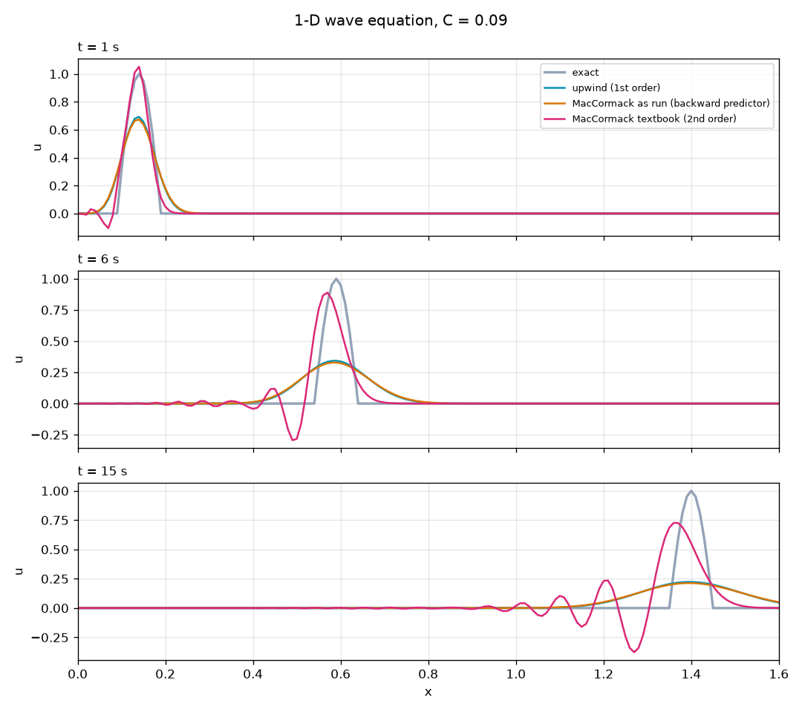

# CFD wave schemes: upwind vs MacCormack

Two classic finite-difference schemes for the 1-D linear wave equation, side by side, with the original Fortran studies and a tested Python port that reproduces their output.

This repo merges two earlier repos, [Upwind-Differencing-Scheme](https://github.com/juw12/Upwind-Differencing-Scheme) and [Explicit-Maccormack-Method](https://github.com/juw12/Explicit-Maccormack-Method). Both are now archived.



## The problem

$$\frac{\partial u}{\partial t} + c\,\frac{\partial u}{\partial x} = 0, \qquad c = 0.09$$

The grid is 301 nodes with $\Delta x = 0.01$ (so $0 \le x \le 3$), and $\Delta t = 0.01$. The initial condition is a half-sine pulse, $u = \sin(10\pi x)$ for $0 \le x \le 0.1$ and $u = 0$ elsewhere. The Courant number is

$$C = \frac{c\,\Delta t}{\Delta x} = 0.09$$

Both schemes are stable for $C \le 1$.

| Scheme | Update | Order |
| --- | --- | --- |
| Upwind | $u_i^{n+1} = u_i^n - C\,(u_i^n - u_{i-1}^n)$ | 1st: smooth but strongly diffusive |
| MacCormack | predictor $\bar u_i = u_i^n - C\,(u_{i+1}^n - u_i^n)$, corrector $u_i^{n+1} = \tfrac12\left[u_i^n + \bar u_i - C\,(\bar u_i - \bar u_{i-1})\right]$ | 2nd: keeps the peak but adds trailing wiggles (dispersion) |

## Results

`python schemes.py` prints the RMS error against the exact (translated) pulse, with the peak height in brackets:

| t (s) | Upwind | MacCormack as run | MacCormack textbook |
| ---: | ---: | ---: | ---: |
| 1 | 0.0452 (0.69) | 0.0476 (0.67) | 0.0216 (1.05) |
| 3 | 0.0736 (0.46) | 0.0759 (0.45) | 0.0424 (0.98) |
| 6 | 0.0889 (0.34) | 0.0907 (0.33) | 0.0687 (0.89) |
| 10 | 0.0978 (0.27) | 0.0993 (0.26) | 0.0872 (0.80) |
| 15 | 0.1036 (0.22) | 0.1048 (0.21) | 0.0999 (0.73) |

The pulse reaches the right boundary at about $t \approx 32$ s, so the later snapshots are mostly empty.

### Two things the merge turned up

1. **The snapshot times are not 1 to 10 s.** The Fortran runs `100*j` *more* steps before writing snapshot `j`, so the snapshots are at 100, 300, 600, ... 5,500 steps, which is $t$ = 1, 3, 6, 10, 15, 21, 28, 36, 45 and 55 s. The old comments said "t=1s until t=10s".
2. **The committed MacCormack results were not from the committed MacCormack code.** `fortran/maccormack.f90` has a forward-difference predictor (the textbook scheme). But the `.plt` files in `results/maccormack/` match a *backward*-difference predictor over the interior nodes to within $10^{-7}$. That variant is only first order and slightly more diffusive than plain upwind, which is why the old MacCormack plots looked like upwind. `schemes.py` has both: `maccormack` (textbook) and `maccormack-run` (what produced the old files).

## Run it

```
pip install numpy matplotlib
python schemes.py              # error table + comparison.png
python tests/test_schemes.py   # port vs Fortran output checks
```

The Fortran sources compile with any Fortran 90 compiler, for example `gfortran fortran/upwind.f90 -o upwind`. Each run writes ten `.plt` files (node index, u) that Gnuplot can plot.

## Files

- `schemes.py`: Python port of all three schemes, exact solution, error table, plot
- `tests/test_schemes.py`: checks that upwind matches `results/upwind/*.plt` and that `maccormack-run` matches `results/maccormack/*.plt` (both within $10^{-5}$), and that textbook MacCormack beats upwind
- `fortran/upwind.f90`, `fortran/maccormack.f90`: the original Fortran
- `results/upwind/`, `results/maccormack/`: the original output and Gnuplot figures

## License

MIT © 2026 Juwen Lie
